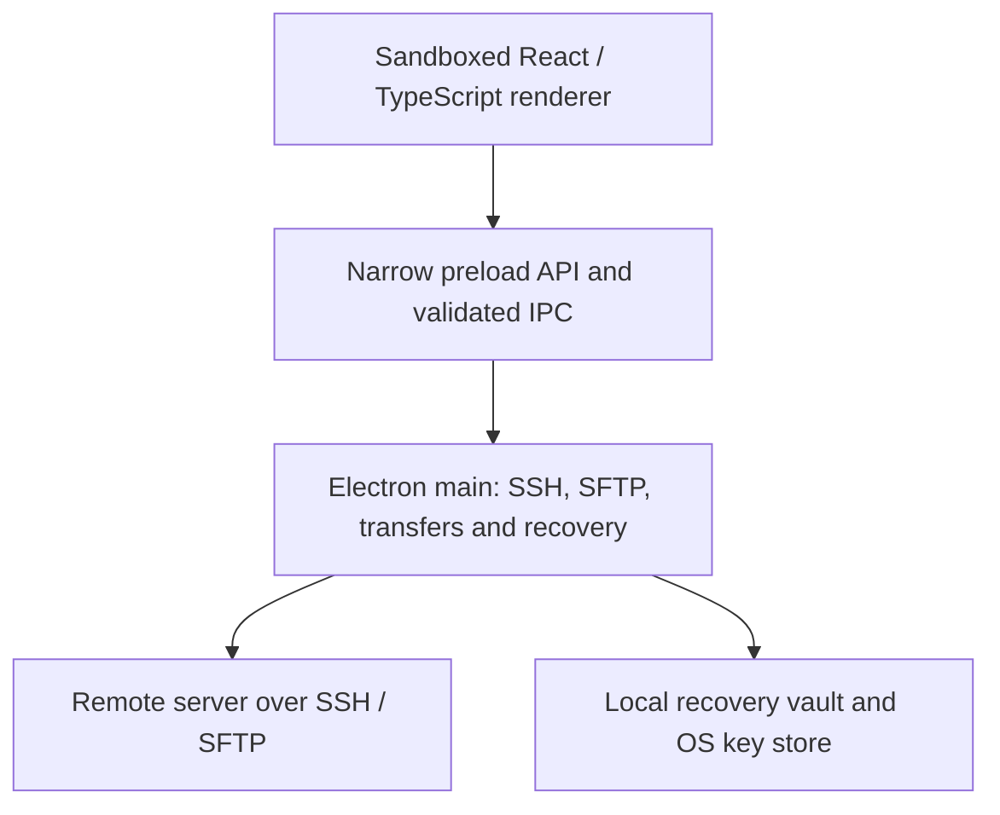

# SSHDrop

### Your SSH workspace. One desktop. Complete control.

SSHDrop is a cross-platform desktop SSH workspace that brings remote terminal access, visual SFTP file management, and reliable file transfers into one application.

Built for developers and system administrators who want a cleaner, safer, and more productive way to manage remote servers without constantly switching between terminal and file-transfer tools.

<p align="center">
  <strong>Windows · Linux · macOS</strong>
</p>

<p align="center">
  <a href="https://github.com/Shukry7/SSH-DROP">GitHub Repository</a> ·
  <a href="https://github.com/Shukry7/SSH-DROP/issues">Report an Issue</a> ·
  <a href="https://github.com/Shukry7/SSH-DROP/blob/main/CONTRIBUTING.md">Contribute</a>
</p>

---

## Project Status

**Status: 0.6.0-alpha.2, early development preview.**

SSHDrop is actively developed, but it is not yet production-ready.

- Core SSH and SFTP functionality is implemented.
- Confirmed transfer recovery, encrypted vault export/import, and recovery-key rotation are implemented.
- Apple Silicon Mac source, desktop, DMG integrity, and packaged-startup checks passed. Native Linux device testing and Intel Mac startup testing remain pending.
- Windows installers are unsigned. Mac packages use ad-hoc signatures without Apple Developer ID signing or notarization.
- Some capabilities available in the development source are not included in older packaged builds.
- The public [0.6.0-alpha.2 release](https://github.com/Shukry7/SSH-DROP/releases/tag/v0.6.0-alpha.2) includes Windows, Linux, and Mac packages with SHA-256 checksums. It remains an alpha preview.

Use disposable test servers and files when evaluating the application.

## Why SSHDrop?

Managing remote servers often means switching between several applications:

- One application for SSH terminal access.
- Another for browsing remote files.
- Another for uploading and downloading files.
- Additional tools for managing backups and recovering interrupted operations.

SSHDrop brings these workflows together.

Instead of treating terminal access and file management as separate experiences, SSHDrop provides a unified workspace where you can connect to servers, execute commands, browse remote directories, edit files, and manage transfers.

## Features

### SSH Workspace

- Password and private-key authentication.
- Up to four independent SSH connection tabs.
- Up to four terminal tabs within each connection.
- Interactive remote terminal with resizing.
- Saved server profiles.
- Beginner connection guidance and field tooltips.
- Explicit server fingerprint verification; changed identities are rejected.
- Explicit reconnect with fresh authentication and no automatic replay.
- Session-only password and private-key passphrase handling.

### Visual SFTP File Manager

- Browse remote directories.
- Upload and download individual files.
- Upload and download folders.
- Queue multiple file transfers.
- Create empty remote files and folders.
- Rename files/folders within a folder; permanently delete regular files and empty folders after confirmation. Recursive deletion is not implemented.
- Copy and move regular files on the same server into existing folders, with confirmation and no replacement of existing destinations. Copies are limited to 128 MiB.
- Inspect and edit ordinary permission bits for one file or folder at a time.
- Drag and drop supported local files after reviewing the destination.
- Edit UTF-8 text files up to 1 MiB with syntax highlighting, search, draft/server comparison, guarded saves, and up to eight editor tabs.
- Open dedicated Nano or Vim terminal tabs when the editor is installed on the server.
- Read-only PNG, JPEG, WebP, and first-frame GIF previews, limited to 10 MiB and 8,388,608 pixels.

### Reliable File Transfers

File operations should be predictable, even when network connections fail.

SSHDrop includes:

- Transfer progress and cancellation.
- SHA-256 integrity verification.
- Temporary-file staging.
- Destination conflict handling.
- Skip file, Keep both, and guarded replacement options.
- Explicit Replace without backup, with a separate warning: this is permanent and has no rollback.
- Opt-in encrypted saved-transfer records and checkpoints with a confirmed retry or supported resume.
- Folder transfer recovery and reviewed merges into existing destinations.
- Encrypted recovery backups.
- Recovery inspection and rollback workflows.

Recovery and replacement capabilities depend on the operation, filesystem, server support, and application version. Upload replacement requires OpenSSH atomic rename support. Folder scans are bounded to 100 items, 16 levels, and 10 GiB. Upload verification reads the staged remote contents back, adding network traffic; local no-replacement publication requires hard-link support.

An interrupted publication can have an uncertain outcome. Inspect retained records and partial results before retrying; nothing is automatically rolled back or replayed. See [transfer recovery](docs/TRANSFER_RECOVERY.md) and the [manual testing checklist](docs/MANUAL_TESTING.md).

### Encrypted Recovery Vault

SSHDrop includes an encrypted recovery system designed to help protect backups and support recovery operations.

Capabilities in the current development source include:

- AES-256-GCM authenticated encryption.
- Operating-system-protected vault keys.
- Individual password-protected backup export and offline restore-to-copy, up to 32 MiB.
- Whole-vault export/import, up to 100 backups and 64 MiB of contents.
- Confirmed recovery-vault key rotation.
- Backup verification.
- Recovery-copy restoration.
- Both OS-protected keys are retained during interrupted rotation; retry explicitly to finish.

**Important:** Recovery encryption does not protect against malicious software running under the same operating-system account. Export and verify an independent archive before rotating or moving OS accounts. Losing the original OS key before export can make recovery impossible. Older app versions cannot open a rotated vault. Exported archives and saved-transfer checkpoints use separate keys and are not changed by recovery-vault rotation.

Recovery records are bound to the verified server and account. Imported records permit restore-copy only, not rollback using paths recorded on another computer. Local recovery storage is limited to 100 records and 10 GiB of backup contents. Legacy plaintext backups require explicit migration; migration and deletion are not secure erasure.

See [portable backups and rotation](docs/PORTABLE_BACKUPS.md) for limits, interruption behavior, and OS key-store requirements.

### Saved Commands & Workflows

- Save, edit, delete, search, group, and duplicate workflow definitions locally; the library persists across server changes and restarts.
- Run sequential noninteractive command steps in a selected remote working directory.
- Preview exact scripts with typed variable inputs before execution.
- Confirmation is enabled by default. Disabling it requires an explicit warning; Run again respects the saved preference and asks for fresh variable values.
- Stream bounded stdout/stderr and stop on failure, timeout, cancellation, or connection loss.
- Import and export workflow definitions as readable JSON; imports open for review with new IDs and confirmation enabled.

Imported workflows should always be reviewed before execution. Exports contain commands and settings, which may include private details. Interactive programs and password prompts belong in the terminal. See [saved workflows](docs/WORKFLOWS.md).

### Idle Session Protection

- Optional inactivity protection, off by default.
- A visible timer and final-minute countdown with an explicit Stay active action.
- Disconnect-and-clear on expiry and supported OS lock/sleep events, invalidating pending approvals.
- A privacy screen replaces the workspace; returning requires a fresh SSH connection.

Expiry can interrupt active work. Authenticated app unlocking that keeps connections running is not implemented. See [idle protection](docs/IDLE_PROTECTION.md).

---

## Screenshots & Demo

Screenshots and a short demonstration video will be added here as the interface and release experience stabilize.

Recommended demonstrations:

1. Connecting to a remote Linux server.
2. Working with multiple terminal sessions.
3. Browsing remote files through SFTP.
4. Uploading and downloading files.
5. Recovering an interrupted transfer.
6. Managing encrypted recovery backups.

---

## Security

Security is a core design consideration in SSHDrop.

Current security-oriented design decisions include:

| Area                    | Approach                                                                                                     |
| ----------------------- | ------------------------------------------------------------------------------------------------------------ |
| SSH host verification   | Explicit trust confirmation for unknown fingerprints                                                         |
| Changed host identities | Rejected rather than silently accepted                                                                       |
| Credentials             | Session-only passwords/passphrases; saved profile metadata and key-file locations remain unencrypted locally |
| Private keys            | Remain on the local machine                                                                                  |
| File transfers          | Temporary staging and SHA-256 verification                                                                   |
| File replacement        | Explicit confirmation and guarded replacement                                                                |
| Recovery backups        | Authenticated encryption with AES-256-GCM                                                                    |
| Vault keys              | Operating-system-protected storage                                                                           |
| Workflow execution      | Exact previews and default-on confirmation controls                                                          |
| Renderer boundary       | Sandboxing, context isolation, and a narrow validated preload/IPC API                                        |

SSHDrop does not automatically replay commands, transfers, or workflows after reconnecting.

### Security limitations

SSHDrop is an early development preview.

It has not undergone a comprehensive independent security audit. Unsigned installers and platform-specific limitations also remain.

Do not use it for sensitive production infrastructure without conducting your own security assessment.

For vulnerability reporting, see [SECURITY.md](SECURITY.md). See the [privacy policy](PRIVACY.md) for local-data retention and the [security review](docs/SECURITY_REVIEW.md) for threat boundaries and remaining validation.

---

## Technology Stack

| Technology       | Purpose                        |
| ---------------- | ------------------------------ |
| Electron         | Cross-platform desktop runtime |
| React            | User interface                 |
| TypeScript       | Application development        |
| Node.js          | Backend application logic      |
| SSH2             | SSH and SFTP connectivity      |
| Zod              | Data validation                |
| Vitest           | Unit and regression testing    |
| Playwright       | Desktop end-to-end testing     |
| Electron Builder | Application packaging          |

---

## Architecture

SSHDrop separates its desktop interface from privileged application operations.



This is a conceptual overview of the application architecture.

---

## Getting Started

### For users

Download the [0.6.0-alpha.2 preview](https://github.com/Shukry7/SSH-DROP/releases/tag/v0.6.0-alpha.2): Windows x64 installer, Linux x64 AppImage/Debian package, or macOS Apple Silicon/Intel DMG. Choose the correct architecture and verify the download against the attached `SHA256SUMS.txt`.

The Mac packages are ad-hoc signed and not notarized. Package checks do not establish normal Gatekeeper acceptance on another Mac.

See [Installation Guide](docs/INSTALLING.md) for platform-specific instructions and known limitations.

End users do not need Node.js or npm to run a packaged application.

### For developers

#### Requirements

- Node.js 24
- npm
- Git
- A development environment supported by Electron

#### Clone the repository

```bash
git clone https://github.com/Shukry7/SSH-DROP.git

cd SSH-DROP
```

#### Install dependencies

```bash
npm ci
```

#### Start development

```bash
npm run dev
```

### Available commands

```bash
# Development
npm run dev

# Application checks
npm run check

# Test coverage
npm run test:coverage

# Desktop end-to-end tests
npm run test:e2e

# Build application
npm run build

# Create unpacked application
npm run package:dir

# Create development installers
npm run dist
```

Desktop end-to-end tests require the generated application in `out/`. `npm run check` builds only after its earlier checks pass. Run this chain so desktop tests stop if checks or the build fail:

```bash
npm run check && npm run test:e2e
```

For a separate build, use `npm run build` before `npm run test:e2e`.

For headless Linux environments:

```bash
xvfb-run -a npm run test:e2e
```

Build and validate release packages on their respective target operating systems. After packaging, run `npm run security:package`; on macOS, also run `npm run security:mac-package` to check both DMGs and startup on the host architecture. `npm run security:audit` and `npm run security:secrets` check dependency policy and tracked-file secrets.

---

## Platform Support

| Platform | Architecture  | Status                                                                                                                |
| -------- | ------------- | --------------------------------------------------------------------------------------------------------------------- |
| Windows  | x64           | Local checks, desktop tests, package fuses, and packaged startup passed; unsigned                                     |
| Linux    | x64           | Ubuntu WSL checks, desktop tests, package fuses, and startup passed; native desktop/key-store validation pending      |
| macOS    | Apple Silicon | Native checks and desktop tests passed; DMG integrity, ad-hoc signature, version, ASAR, and packaged startup verified |
| macOS    | Intel         | DMG integrity, ad-hoc signature, version, ASAR, and fuses verified; Intel startup pending                             |

The availability of a generated package does not mean that every platform and architecture has been independently validated.

See [INSTALLING.md](docs/INSTALLING.md) for current packaging and compatibility information.

---

## Roadmap

SSHDrop is being developed incrementally, with reliability and security taking priority over feature quantity.

### Current development priorities

- [ ] Maintain cross-platform CI and release checks.
- [ ] Native Linux desktop/key-store validation, Intel Mac startup testing, and broader OS key-store lifecycle testing.
- [ ] Apple Developer ID signing/notarization and Windows signing.
- [ ] Independent security review, accessibility review, and power-loss/recovery testing.
- [ ] Improve onboarding and installation guidance.

### Future possibilities

- [ ] Authenticated app locking that can keep active connections running.
- [ ] Optional OS-backed saved SSH credentials.
- [ ] Remote editor merging and additional text encodings.
- [ ] Recursive deletion with a separate destructive-operation design.
- [ ] Container filesystem browsing, remote-to-remote transfers, and native drag-out.
- [ ] Mobile Bridge with a separate pairing, TLS, permission, and revocation design.

Roadmap items are proposals and may change as development progresses. See the [detailed roadmap](docs/ROADMAP.md) for implemented scope and future work.

---

## Contributing

SSHDrop is an open-source project, and contributions are welcome.

You can contribute through:

- Bug reports.
- Feature suggestions.
- Documentation improvements.
- Testing on different operating systems.
- Code contributions.
- Security-related improvements.

Before submitting a pull request:

1. Review existing issues.
2. Create a focused branch.
3. Include tests for new functionality.
4. Run the available project checks.
5. Document important behavioral changes.

Read [CONTRIBUTING.md](CONTRIBUTING.md) before contributing.

Please never include passwords, private keys, credentials, or sensitive server information in issues or pull requests.

---

## Project Documentation

| Document                                       | Description                                             |
| ---------------------------------------------- | ------------------------------------------------------- |
| [Installation](docs/INSTALLING.md)             | Installation and platform limitations                   |
| [Contributing](CONTRIBUTING.md)                | Contribution guidelines                                 |
| [Security](SECURITY.md)                        | Security policy and vulnerability reporting             |
| [Privacy](PRIVACY.md)                          | Privacy and local-data handling                         |
| [Changelog](CHANGELOG.md)                      | Version history and changes                             |
| [Architecture](docs/ARCHITECTURE.md)           | Desktop boundaries and application structure            |
| [Manual testing](docs/MANUAL_TESTING.md)       | Feature checks using disposable data                    |
| [Transfer recovery](docs/TRANSFER_RECOVERY.md) | Saved transfers, supported resume, and folder recovery  |
| [Vault portability](docs/PORTABLE_BACKUPS.md)  | Exports, imports, key rotation, and recovery limits     |
| [Workflows](docs/WORKFLOWS.md)                 | Saved commands, variables, previews, and rerun behavior |
| [Versioning](docs/VERSIONING.md)               | Version source, checks, and release flow                |
| [Documentation](docs/)                         | Architecture, testing, design and feature documentation |

---

## License

SSHDrop is released under the [MIT License](LICENSE).

You are free to use, modify, and distribute the software under the terms of the license.

---

## Author

**Faik Ahmed Sukry**

Software Engineer · Open-Source Developer

GitHub: [@Shukry7](https://github.com/Shukry7)

---

<p align="center">

<strong>SSHDrop</strong>

A better workspace for working with remote servers.

Built with care for developers who work beyond their local machine.

<a href="https://github.com/Shukry7/SSH-DROP">Explore the repository</a>

</p>
